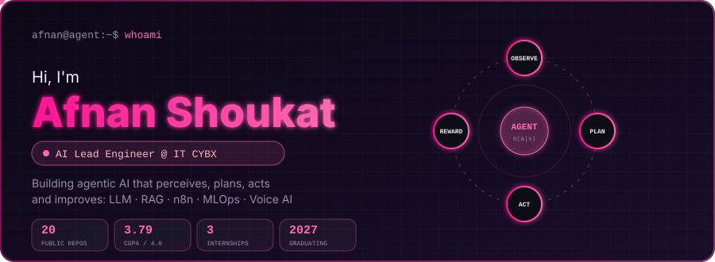
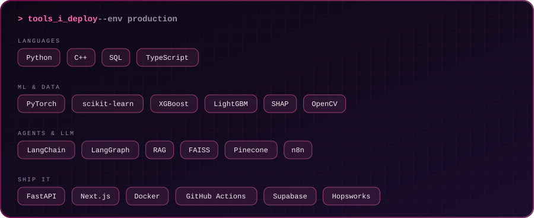
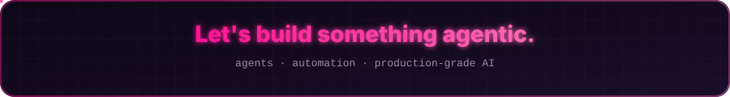

<!-- ======== TOP WAVE HEADER ======== -->

  

<!-- ======== HERO ======== -->

  

  

  
  
  
  

  

## 💡 About Me
Hi, I'm **Afnan Shoukat**, an **AI Lead Engineer** based in Islamabad. I design and ship end-to-end AI systems: ML pipelines, LLM/RAG agents, voice AI and business-workflow automation, from data ingestion to a live dashboard.

- 🏢 **AI Lead Engineer at [IT CYBX](https://itcybx.co.uk)**: agents, chatbots and AI-integrated systems that remove repetitive admin work for growing teams
- 🎓 Final-year **BS Artificial Intelligence** student at NUML (CGPA 3.79 / 4.0)
- 💼 Interned at **NeuroG.AI** (quant ML), **10Pearls Pakistan** (MLOps) and **Prudential Solutions** (conversational AI)
- 🤝 I mentor juniors in AI automation (Python, LangChain, LangGraph, n8n)
- 🌱 Currently focused on making AI prototypes **production-ready**: validation, fallbacks, monitoring and guardrails

  

  

  

## 🧠 Tech Stack & Tools

  

  

## 🚀 Featured Missions

<table>
  <tr>
    <td width="50%" valign="top">
      <h3 align="center">📈 CryptoSight</h3>
      

        
      

      

        Solo-built <b>quant trading platform</b>: Reddit sentiment (FinBERT), 12 ML signal models, a vectorized backtester (fees, slippage, drawdown) and live Bybit-testnet execution with a React dashboard.
      

      

    </td>
    <td width="50%" valign="top">
      <h3 align="center">🌫️ AirLyst</h3>
      

        
      

      

        Serverless <b>MLOps pipeline</b> forecasting Islamabad's AQI 72h ahead. Hopsworks Feature Store, weekly model tournament (LightGBM <b>R² 0.986</b>), GitHub Actions retraining, SHAP explanations. <a href="https://air-lyst.vercel.app">Live demo</a>.
      

      

    </td>
  </tr>

  <tr>
    <td width="50%" valign="top">
      <h3 align="center">🧾 BillSense</h3>
      

        
      

      

        Decodes <b>K-Electric, LESCO and IESCO bills</b> into structured JSON with local OCR, layout rules and arithmetic checks, then answers questions in plain English. Built for Women Tech Quest 2026.
      

      

    </td>
    <td width="50%" valign="top">
      <h3 align="center">🎙️ VoiceIQ</h3>
      

        
      

      

        <b>Voice-only RAG assistant</b>: Deepgram STT, FAISS retrieval, multi-LLM routing (Gemini / DeepSeek / Kimi) and spoken answers, served with FastAPI.
      

      

    </td>
  </tr>

  <tr>
    <td width="50%" valign="top">
      <h3 align="center">👥 Multi-Role Hiring Automation</h3>
      

        
      

      

        n8n pipeline that validates and deduplicates applications, grades resumes with AI (strong / average / weak), then auto-schedules interviews or sends rejections.
      

      

    </td>
    <td width="50%" valign="top">
      <h3 align="center">💬 IT CYBX Live Bot</h3>
      

        
      

      

        Bilingual (EN/AR) <b>AI sales chatbot</b> for itcybx.co.uk: RAG FAQ answering, lead capture, Calendly booking and team alerts, built with LangGraph, Pinecone and FastAPI.
      

      

    </td>
  </tr>
</table>

  

  

## 🧪 Side Quests

| Mission | What it does | Stack | Repo |
|---|---|---|---|
| **TumorSense-AI** | Brain MRI tumour classification | CNN · ResNet-18 · Transfer learning | [Open](https://github.com/21Afnan/TumorSense-AI) |
| **NeuroAssistAI** | Tumour + glioma-stage detection | Deep learning · Medical imaging | [Open](https://github.com/21Afnan/NeuroAssistAI) |
| **Inbox Guardian** | AI email triage agent with Discord alerts | n8n · Gemini · Discord | [Open](https://github.com/21Afnan/Inbox_Guardian) |
| **SOC Advisor** | Cybersecurity incident-response copilot | Mistral 7B · RAG | [Open](https://github.com/21Afnan/SOC_Analyst_Advisor) |
| **PakShield AI** | Border monitoring and threat intel | Computer vision · Threat intel | [Open](https://github.com/21Afnan/PakShield_Defence_AI) |
| **CycleSenseAI** | Cycle prediction with a health chatbot | LSTM · Supabase · Chatbot | [Open](https://github.com/21Afnan/CycleSenseAI) |
| **Voice Modules** | STT, TTS and speech-to-speech APIs | FastAPI · OpenAI · Real-time | [Open](https://github.com/21Afnan/Voice_Module) |

  

## 📫 Let's Connect

  

  
  
  

  

✨ "AI isn't replacing humans, it's amplifying creativity." ✨

  

